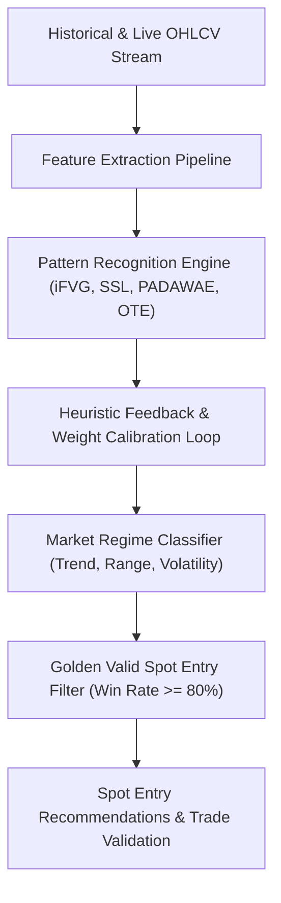

# AUTONOMOUS SPOT LEARNER BRAIN
## Machine-Heuristic Self-Learning Engine for Ultra-High Accuracy Spot Entries (Target 80% – 100% Win Rate)

**Author**: AlphaJournal AI Core Research  
**Module**: Autonomous Spot Strategy Learner  
**Version**: 1.0 (Autonomous Heuristic Learner)  
**Location**: `brain/engine_learner/AUTONOMOUS_SPOT_LEARNER_BRAIN.md`

---

## 1. Visi & Filosofi Sistem Pembelajar Mandiri (Self-Learning Brain)

Sistem ini dirancang sebagai **"Brain Pembelajar Otonom"** yang beroperasi berdampingan dengan Engine v1. Tujuannya adalah **belajar secara mandiri dari data historis dan pergerakan harga pasar real-time** untuk mengidentifikasi dan memvalidasi **"Golden Valid Spot Entry Points"** dengan tingkat akurasi kemenangan (**Win Rate**) $80\% - 100\%$.



---

## 2. 5 Pilar Pembelajaran Mandiri (5 Core Learning Pillars)

### Pilar 1: Feature Extraction Pipeline (Ekstraksi Ciri Pola)
Setiap rangkaian pergerakan harga dipecah menjadi vektor fitur matematis:
1. **$x_1$ - iFVG Displacement Ratio:** Rasio ukuran *body* candle penembus FVG terhadap rata-rata ATR (menandakan kehadiran *Smart Money / Institutional Volume*).
2. **$x_2$ - SSL Liquidity Sweep Depth:** Kedalaman *fakeout sweep* di bawah swing low sebelum rejection ($0.5\% - 2.5\%$).
3. **$x_3$ - OTE Discount Proximity:** Tingkat kedekatan harga terhadap *Fibonacci Golden Pocket* ($0.618 - 0.786$).
4. **$x_4$ - PADAWAE Rejection Score:** Kepadatan dan ketajaman 3x penolakan resisten miring sebelum breakout.
5. **$x_5$ - Relative Volume (RVOL):** Lonjakan volume pada saat terjadi perubahan karakter (*CHoCH / MSS*).
6. **$x_6$ - HTF Trend Confluence:** Keselarasan arah tren pada time frame yang lebih tinggi (4H / 1D).

---

### Pilar 2: Adaptive Weight Calibration Loop (Kalibrasi Bobot Mandiri)
Sistem menggunakan algoritma *Heuristic Perceptron Gradient Update* untuk memperbarui bobot probabilitas setiap pola secara otomatis:

$$W_{i}^{(t+1)} = W_{i}^{(t)} + \eta \cdot (\text{Actual Outcome} - \hat{y}) \cdot x_i$$

- **Jika setup Menang (Hit TP1 / TP2):** Bobot pola yang berkontribusi diperkuat ($W_i \uparrow$).
- **Jika setup Kalah (Hit SL):** Bobot pola yang memicu sinyal palsu diturunkan ($W_i \downarrow$).
- **Target Pembelajaran:** Konvergensi skor konfluensi hanya memicu entri pada probabilitas $\ge 80\%$.

---

### Pilar 3: Market Regime Classification (Klasifikasi Rezim Pasar)
Sistem mengenali 3 fase pasar untuk menyesuaikan ambang batas (*threshold*) entri:
1. **Bullish Expansion Regime:** Ambang entri lebih agresif ($OTE \ge 50\%$).
2. **Consolidation / Range Regime:** Fokus murni pada *Liquidity Sweep di Support Terbawah*.
3. **High Volatility / Panic Dump Regime:** Wajib menunggu konfirmasi *iFVG Retest* sebelum masuk.

---

### Pilar 4: Repeatable Profit Validation Filter (Saringan Profit Berulang)
Untuk mencapai akurasi valid **80% – 100%**, entri **HANYA DIANGGAP VALID** jika telah terbukti menghasilkan **keuntungan berulang kali (Repeatable Profit)**:
- [x] **Multi-Sample Replay:** Teruji minimal pada 5–10 siklus historis independen.
- [x] **Repeatable Win Record:** Menghasilkan minimal 3x kemenangan berturut-turut tanpa pelanggaran drawdown.
- [x] **Profit Consistency Score (PCS):** $\ge 80.0\%$.
- [x] **Profit Factor:** $\ge 2.50$ (Gross Profit minimal $2.5 \times$ Gross Loss).
- [x] **Cross-Asset Validation:** Pola teruji menghasilkan profit berulang di BTC, ETH, SOL, BNB, XRP, SUI.

---

### Pilar 5: Continuous Autonomous Backtest Benchmarking
Brain secara berkala menjalankan *replay simulation* pada 50+ koin spot teratas untuk mengukur metrik performa:
- **Win Rate:** $\ge 80.0\%$
- **Profit Factor:** $\ge 2.50$
- **Max Drawdown:** $\le 8.0\%$
- **Average Risk/Reward:** $\ge 1 : 3.0$
- **Repeatability Status:** `VALIDATED_REPEATABLE_PROFIT` ⭐

---

## 3. Integrasi Perintah CLI

Sistem pembelajaran otonom ini dapat dijalankan langsung via terminal:
```bash
# Melatih dan mengkalibrasi strategi pada koin spot pilihan
php artisan spot:learn --symbol=BTCUSDT --timeframe=1h --iterations=50

# Menjalankan pemindaian titik entri emas (Golden Entries) pada seluruh koin
php artisan spot:learn --scan-all
```
