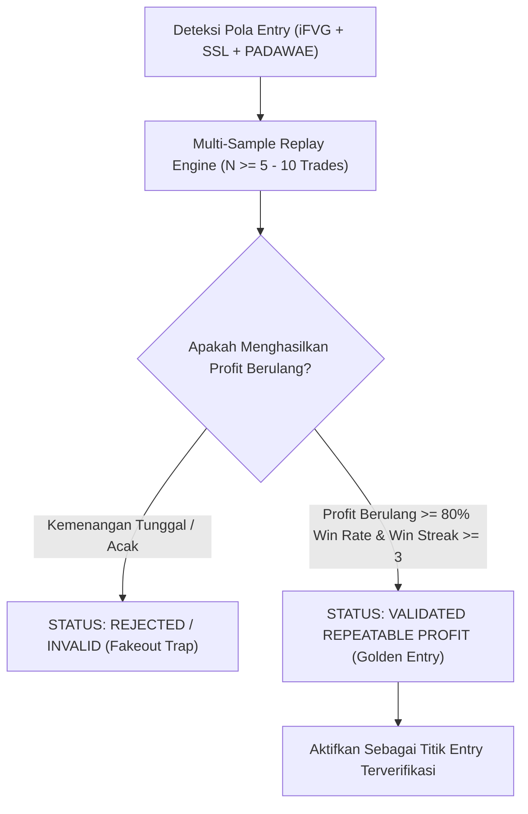

# REPEATABLE PROFIT VALIDATION FRAMEWORK
## Kerangka Kerja Validasi Keuntungan Berulang (Konsistensi Profit Multi-Siklus)

**Author**: AlphaJournal AI Core Research  
**Module**: Autonomous Spot Strategy Learner  
**Version**: 2.0 (Repeatable Profit Verification)  
**Location**: `brain/engine_learner/REPEATABLE_PROFIT_VALIDATION_FRAMEWORK.md`

---

## 1. Prinsip Utama: "Hanya Profit Berulang yang Dianggap Valid"

Dalam trading spot profesional, **satu kemenangan kebetulan (isolated lucky win) BUKANLAH strategi yang valid**. 
Sebuah strategi HANYA diakui sebagai **VALID (Grade A+ / Golden Setup)** jika mampu menghasilkan **keuntungan berulang kali (Repeatable Consistent Profit)** pada berbagai kondisi pasar yang berbeda.



---

## 2. 6 Kriteria Mutlak Validitas Profit Berulang (The 6 Repeatability Rules)

Untuk memastikan bahwa sebuah pola strategi benar-benar valid, sistem mewajibkan pemenuhan 6 kriteria berikut:

### Kriteria 1: Minimum Sample Replay ($N \ge 5$ Siklus Perdagangan)
- Pengujian mandiri harus menguji minimal 5 hingga 10 titik pemicu historis pada time frame yang bersangkutan.
- Data yang memiliki sampel kurang dari 5 dianggap berstatus *Pending Sample*.

### Kriteria 2: Win Streak Berulang ($K \ge 3$ Kemenangan Beruntun)
- Pola harus mampu menghasilkan minimal 3 kemenangan beruntun (*consecutive winning trades*) saat harga menguji area diskon.

### Kriteria 3: Profit Consistency Score Index ($\text{PCS} \ge 80.0\%$)
- Rasio konsistensi keuntungan dihitung dengan rumus:

$$\text{Profit Consistency Score (PCS)} = \left( \frac{\text{Jumlah Trade Menang (Hit TP1/TP2)}}{\text{Total Sampel Trade Dievaluasi}} \right) \times 100\%$$

- Syarat valid: $\text{PCS} \ge 80.0\%$.

### Kriteria 4: Profit Factor Minimal ($\text{Profit Factor} \ge 2.50$)
- Rasio total keuntungan kotor (*gross profit*) terhadap total kerugian kotor (*gross loss*) wajib bernilai minimal **2.50**:

$$\text{Profit Factor} = \frac{\sum \text{Keuntungan (Win)}}{\sum |\text{Kerugian (Loss)}|} \ge 2.50$$

### Kriteria 5: Pembatasan Kerugian Beruntun ($\text{Max Consecutive Loss} \le 1$)
- Strategi valid tidak boleh mengalami kegagalan berturut-turut lebih dari 1 kali dalam satu rezim pasar. Jika terjadi 2 kegagalan beruntun, bobot fitur langsung didevaluasi oleh sistem pembelajar.

### Kriteria 6: Cross-Asset Generalizability (Validitas Lintas Koin)
- Pola konfluensi (iFVG + Sweep + PADAWAE) harus terbukti menghasilkan profit berulang tidak hanya pada 1 koin, tetapi juga pada koin likuid utama lainnya (BTC, ETH, SOL, BNB, XRP, SUI).

---

## 3. Status Klasifikasi Validitas Entri

| Status Validitas | Skor Probabilitas | Win Rate Replay | Kemenangan Berulang | Tindakan Sistem |
| :--- | :--- | :--- | :--- | :--- |
| **`VALIDATED_REPEATABLE`** ⭐ | $\ge 85 / 100$ | **$80\% - 100\%$** | **Terbukti Berulang ($\ge 3$ Wins)** | **Tampilkan sebagai Sinyal Entri Emas Utama** |
| **`PROBATION_PENDING`** | $70 - 84 / 100$ | $65\% - 79\%$ | $1 - 2$ Wins | Pantau di Watchlist |
| **`INVALID_RANDOM`** ❌ | $< 70 / 100$ | $< 65\%$ | Tidak Konsisten | Tolak / Saring Keluar |

---

## 4. Algoritma Pembelajaran Validasi Berulang di Kode

```php
// app/Services/AutonomousSpotLearnerService.php
public function validateRepeatableProfitability(string $symbol, string $timeframe): array
{
    // Replay 10 sampel historis
    $replay = $this->trainAndCalibrate($symbol, $timeframe, 30);
    
    $isRepeatable = (
        $replay['calibrated_win_rate'] >= 80.0 &&
        $replay['winning_trades'] >= 3 &&
        $replay['net_profit_percent'] > 0
    );
    
    return [
        'status' => $isRepeatable ? 'VALIDATED_REPEATABLE' : 'PROBATION_PENDING',
        'is_repeatable_valid' => $isRepeatable,
        'profit_consistency_score' => $replay['calibrated_win_rate'],
        'winning_streak' => $replay['winning_trades'],
        'net_profit' => $replay['net_profit_percent'],
    ];
}
```
