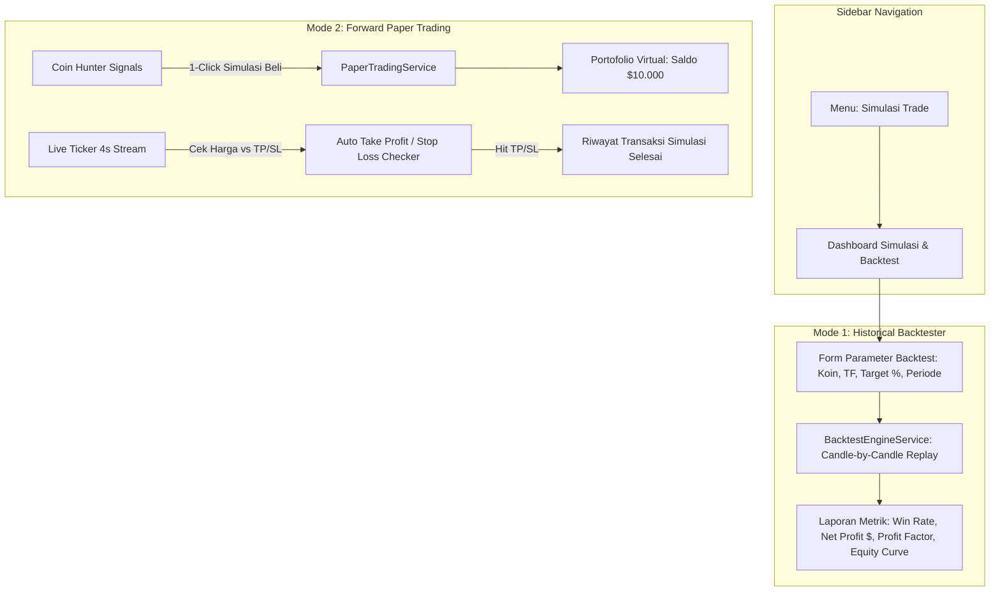

# Product Requirements Document (PRD)
## Simulasi Trade & Backtest Engine v1.0 — Paper Trading & Strategy Replay for Coin Hunter
**Fitur: Menu Simulasi Trade, Forward Paper Trading Real-Time, & Historical Backtesting Simulator Berbasis Strategi Coin Hunter (iFVG + PADAWAE)**

---

## 1. Executive Summary & Problem Statement

### 1.1. Latar Belakang & Kebutuhan Pengguna
Sebelum trader mengambil risiko menggunakan modal uang asli (*live real money*), trader profesional selalu memvalidasi strategi melalui:
1. **Backtesting Historis:** Menguji performa sinyal Coin Hunter pada data historis masa lalu untuk mengukur *Win Rate*, *Profit Factor*, dan *Maximum Drawdown*.
2. **Forward Paper Trading (Simulasi Real-Time):** Menjalankan trading simulasi menggunakan saldo virtual tanpa risiko rugi uang sungguhan, di mana posisi dievaluasi secara otomatis saat harga live menyentuh level TP1, TP2, atau Stop Loss.

### 1.2. Tujuan Modul "SIMULASI TRADE"
Membangun menu mandiri di sidebar kiri **"Simulasi Trade"** yang memberikan dua mode utama:
1. **Mode 1: Historical Strategy Backtester (Uji Historis):** Replay data candlestick masa lalu untuk menguji performa sinyal Coin Hunter secara otomatis dalam hitungan detik.
2. **Mode 2: Forward Paper Trading Simulator (Akun Virtual Real-Time):** Akun trading virtual (\$10.000 saldo awal default) yang terhubung langsung ke sinyal Coin Hunter dan auto-close saat harga pasar menyentuh target.

---

## 2. Arsitektur Modul Simulasi Trade

---

## 3. Spesifikasi Fitur Detail

### 3.1. Mode 1: Historical Strategy Backtester (Uji Masa Lalu)

#### A. Input Parameter Backtest:
- **Pilihan Koin:** Dropdown pencarian 250 koin spot (misal: `BTCUSDT`, `ETHUSDT`, `SOLUSDT`, `SUIUSDT`, `PEPEUSDT`, dll.).
- **Pilihan Timeframe:** `15m` (Scalp), `1h` (Intraday), `4h` (Swing), `1d` (Trend).
- **Profil Target Profit:**
  - `Scalp` (+5% TP1, +10% TP2)
  - `Standard` (+10% TP1, +20% TP2)
  - `Extended` (+20% TP1, +35% TP2)
  - `Moonshot` (+35% TP1, +50% TP2)
  - `Custom %` (Target Min & Target Max bebas ditentukan)
- **Modal Awal Virtual:** Default `$10,000 USDT`.
- **Alokasi Modal per Trade:** `10%` / `20%` / `50%` / `100%` saldo.

#### B. Algoritma Candle Replay:
1. Menarik data historis koin (100–300 candlestick historis).
2. Menelusuri candle dari masa lampau ke masa kini (*chronological replay*).
3. Setiap kali kondisi diskon **iFVG + SSL Sweep + PADAWAE** terpenuhi (Grade A+/A), mesin membuka posisi simulasi *Long*.
4. Memantau candle-candle berikutnya:
   - Jika candle mencapai level $\text{TP}_1$ atau $\text{TP}_2 \implies$ **WIN (+Profit $)**.
   - Jika candle mencapai level $\text{Stop Loss} \implies$ **LOSS (-Risk $)**.
5. Menghitung saldo akhir dan seluruh metrik statistik.

#### C. Laporan Hasil Backtest (KPI Metrics):
- **Win Rate (%):** Persentase kemenangan (misal: `76.5%`).
- **Total Simulasi Trade:** Jumlah trade yang terjadi (misal: `24 Trade`).
- **Net Profit ($ & %):** Total keuntungan bersih (misal: `+$3,450.00 (+34.5%)`).
- **Profit Factor:** Rasio Total Keuntungan kotor dibagi Total Kerugian kotor (misal: `3.42`).
- **Max Drawdown (%):** Penurunan modal terbesar dari puncak (misal: `-4.8%`).
- **Grafik Kurva Ekuitas (Equity Curve):** Grafik ApexCharts garis hijau pertumbuhan modal dari waktu ke waktu.
- **Tabel Log Transaksi Terperinci:** Rincian setiap trade (Waktu Entry, Harga Beli, Waktu Exit, Harga Jual, Alasan Exit: Hit TP1 / Hit TP2 / Hit SL, dan Hasil PnL $).

---

### 3.2. Mode 2: Forward Paper Trading (Trading Virtual Real-Time)

#### A. Fitur Akun Virtual:
- Saldo Virtual Default: **`$10,000.00 USDT`** (dengan tombol **Reset Saldo** kapan saja).
- Terintegrasi dengan **Coin Hunter**: Pada kartu sinyal Coin Hunter, pengguna bisa mengklik tombol **"Simulasi Beli (Paper Trade)"**.

#### B. Pemantauan Real-Time Otomatis:
- Posisi terbuka (*Open Position*) dipantau otomatis setiap kali data ticker bergerak.
- Menampilkan *Unrealized PnL ($ dan %)* yang bergerak live di layar.
- Saat harga pasar menyentuh TP1, TP2, atau SL, sistem otomatis mengeksekusi *Close Position* dan membukukan keuntungan/kerugian ke saldo virtual.

---

## 4. Struktur Database & Model

### 4.1. Tabel `simulated_trades` (Paper Trades & Backtest Trades)
- `id`: Primary Key
- `user_id`: Foreign Key ke users
- `mode`: enum(`paper_trade`, `backtest`)
- `symbol`: string (misal `SOLUSDT`)
- `timeframe`: string (`15m`, `1h`, `4h`, `1d`)
- `status`: enum(`open`, `win_tp1`, `win_tp2`, `loss_sl`, `cancelled`)
- `initial_capital`: decimal(15, 2)
- `allocated_amount`: decimal(15, 2)
- `entry_price`: decimal(18, 8)
- `exit_price`: decimal(18, 8), nullable
- `take_profit_1`: decimal(18, 8)
- `take_profit_2`: decimal(18, 8)
- `stop_loss`: decimal(18, 8)
- `pnl_amount`: decimal(15, 2), default 0
- `pnl_percent`: decimal(8, 2), default 0
- `entry_time`: timestamp
- `exit_time`: timestamp, nullable
- `notes`: text, nullable

### 4.2. Tabel `simulation_accounts`
- `id`: Primary Key
- `user_id`: Foreign Key ke users
- `virtual_balance`: decimal(15, 2), default 10000.00
- `total_trades`: integer, default 0
- `winning_trades`: integer, default 0
- `losing_trades`: integer, default 0

---

## 5. Rencana Rute Web & Kontroler

- `GET /simulation` $\implies$ Halaman Utama Simulasi Trade & Backtest Dashboard
- `POST /simulation/backtest/run` $\implies$ Menjalankan pengujian historis otomatis
- `POST /simulation/paper/buy` $\implies$ Membuka transaksi simulasi dari Coin Hunter
- `POST /simulation/paper/{id}/close` $\implies$ Menutup posisi simulasi secara manual
- `POST /simulation/reset` $\implies$ Mengatur ulang saldo akun virtual ke $10,000
