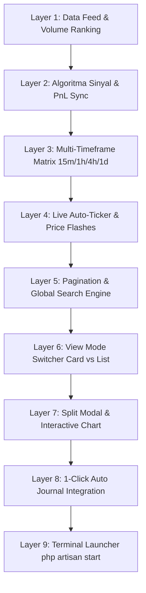

# Quality Assurance & Testing PRD
## Coin Hunter v1.6 — Master Test Matrix & Verification Blueprint
**Rencana Pengujian Menyeluruh: Pengujian Algoritma, Data Feed Real-Time, Pagination, Multi-Timeframe, PnL Sync, & Auto-Journaling**

---

## 1. Tujuan Pengujian (Testing Objectives)
Memastikan seluruh komponen dan fitur dalam modul **Coin Hunter** berjalan 100% presisi, stabil, tanpa bug tersembunyi, memiliki performa berlatensi rendah, serta memberikan pengalaman trading spot yang akurat dan dapat diandalkan bagi pengguna.

---

## 2. Matriks Pengujian Komprehensif (9 Layer Testing Matrix)



---

### Layer 1: Market Data Feed & 24h Volume Ranking Integrity
- [ ] **TC-1.1:** Verifikasi `MarketDataFetcherService` mengambil hingga 250 koin spot aktif dari API Gate.io / CoinGecko.
- [ ] **TC-1.2:** Verifikasi seluruh stablecoin murni (*USDT, USDC, DAI, USDe, USDS, FDUSD, dll.*) dan *staking derivative* (*WBTC, STETH, WETH, dll.*) **terfilter bersih** dari radar.
- [ ] **TC-1.3:** Verifikasi pengurutan volume 24 jam bersifat **menurun (*Strictly Descending*)**:
  - Urutan #1 harus **Bitcoin (BTC/USDT)** dengan volume transaksi terbesar.
  - Urutan #2 harus **Ethereum (ETH/USDT)**.
  - Urutan #3 harus **Solana (SOL/USDT)** atau **XRP/USDT**.
- [ ] **TC-1.4:** Verifikasi waktu respon cache data feed $< 50\text{ms}$ saat dipanggil berulang kali.
- [ ] **TC-1.5:** Verifikasi mekanisme *fallback* jika koneksi API publik mengalami gangguan jaringan sementara.

---

### Layer 2: Algoritma Sinyal & Sinkronisasi Presisi PnL
- [ ] **TC-2.1:** Verifikasi kalkulasi *Dealing Range* ($\text{Swing High} - \text{Swing Low}$), *Equilibrium 50%*, dan *OTE Discount 61.8% – 78.6%*.
- [ ] **TC-2.2:** Verifikasi deteksi *Sell-Side Liquidity (SSL) Sweep* pada candle diskon.
- [ ] **TC-2.3:** Verifikasi deteksi *Inversion Fair Value Gap (iFVG)* saat resisten gap berubah menjadi support.
- [ ] **TC-2.4:** Verifikasi deteksi pola *PADAWAE* (3x penolakan trendline + breakout).
- [ ] **TC-2.5:** Verifikasi skor probabilitas (0 - 100) dan klasifikasi Grade (`A+` $\ge 90$, `A` $\ge 80$, `A-` $\ge 65$).
- [ ] **TC-2.6 (Dual Status):**
  - Jika harga $\le \text{Equilibrium}$ dan skor $\ge 70 \implies$ Status **`TRIGGERED (BELI SEKARANG)`**.
  - Jika harga masih di area Premium ($> 50\%$) $\implies$ Status **`WATCHLIST (TUNGGU DISKON)`**.
- [ ] **TC-2.7 (Sinkronisasi PnL):**
  - $\text{TP}_1 = \text{Entry} \times (1 + \text{TargetMin}/100)$ tepat bernilai $+\text{TargetMin}\%$.
  - $\text{TP}_2 = \text{Entry} \times (1 + \text{TargetMax}/100)$ tepat bernilai $+\text{TargetMax}\%$.
  - $\text{Stop Loss}$ mempertahankan proteksi risiko dengan rasio Risk:Reward $\ge 1:2.5$.
- [ ] **TC-2.8 (Proyeksi Titik Tunggu / Wait Zone):**
  - Menghitung $\text{Wait Price Ideal}$ ($50\%$ Dealing Range).
  - Menghitung $\text{Wait Price OTE}$ ($61.8\%$ Retracement).
  - Menghitung jarak persentase $\text{Distance \%} = \frac{\text{CurrentPrice} - \text{WaitPrice}}{\text{CurrentPrice}} \times 100\%$.

---

### Layer 3: Multi-Timeframe Matrix (`15m`, `1h`, `4h`, `1d`)
- [ ] **TC-3.1:** Verifikasi parameter timeframe `15m`, `1h`, `4h`, `1d` diteruskan dengan benar ke API Candlestick Gate.io.
- [ ] **TC-3.2:** Verifikasi saat trader mengganti timeframe di header, scanner memindai struktur koin untuk periode tersebut.
- [ ] **TC-3.3:** Verifikasi tombol switcher timeframe di dalam modal grafik interaktif dapat mengubah timeframe grafik seketika tanpa menutup modal.

---

### Layer 4: Live Auto-Ticker Stream & Visual Kedip Harga
- [ ] **TC-4.1:** Verifikasi endpoint `GET /signals/live-prices` mengembalikan payload JSON koin real-time yang valid.
- [ ] **TC-4.2:** Verifikasi polling otomatis berjalan setiap 4 detik di latar belakang tanpa reload halaman.
- [ ] **TC-4.3:** Verifikasi visual kedip **Hijau lembut (`bg-emerald-500/20 text-emerald-400`)** saat harga baru $>$ harga lama.
- [ ] **TC-4.4:** Verifikasi visual kedip **Merah lembut (`bg-rose-500/20 text-rose-400`)** saat harga baru $<$ harga lama.
- [ ] **TC-4.5:** Verifikasi transisi kedip kembali normal dalam waktu 800ms secara halus.
- [ ] **TC-4.6:** Verifikasi **TIDAK ADA** kebocoran kode JavaScript di layar browser.

---

### Layer 5: Client-Side Pagination & Global Live Search
- [ ] **TC-5.1:** Verifikasi tabel live koin membagi data 250 koin ke dalam halaman dengan benar (misal: 20 koin per halaman $= 13$ halaman).
- [ ] **TC-5.2:** Verifikasi tombol **Berikutnya (Next)** menggeser tampilan ke koin berikutnya.
- [ ] **TC-5.3:** Verifikasi tombol **Sebelumnya (Prev)** dinonaktifkan (*disabled*) saat berada di Halaman 1.
- [ ] **TC-5.4:** Verifikasi tombol **Berikutnya (Next)** dinonaktifkan (*disabled*) saat berada di Halaman Terakhir.
- [ ] **TC-5.5:** Verifikasi dropdown jumlah per halaman (`15`, `20`, `25`, `50`, `100`) mengubah jumlah baris tabel secara instan dan mereset halaman ke 1.
- [ ] **TC-5.6 (Global Search):**
  - Mengetik simbol koin (misal: `PEPE`, `NEAR`, `INJ`, `RENDER`, `SUI`, `DOGE`) langsung mencari dari **seluruh 250 koin** tanpa terbatas pada halaman aktif.
  - Menghapus teks pencarian mengembalikan pagination ke daftar penuh.

---

### Layer 6: View Mode Switcher (Card View vs List View)
- [ ] **TC-6.1:** Verifikasi tombol **Card View** menampilkan grid kartu sinyal dengan rincian Entry, TP1, TP2, SL, dan RRR.
- [ ] **TC-6.2:** Verifikasi tombol **List View** menampilkan tabel baris yang padat, rapi, dan responsif.
- [ ] **TC-6.3:** Verifikasi filter pencarian berlaku serentak pada kedua mode tampilan.

---

### Layer 7: Interactive Split Modal & Candlestick Annotations
- [ ] **TC-7.1:** Verifikasi modal terbuka dengan halus saat tombol "Lihat Chart" diklik.
- [ ] **TC-7.2 (Anotasi Grafik Sinyal Triggered):**
  - Garis Biru/Hijau putus-putus: Level Entry Diskon.
  - Garis Emerald solid: Target TP1 & TP2.
  - Garis Merah putus-putus: Level Stop Loss.
- [ ] **TC-7.3 (Anotasi Grafik Koin Watchlist):**
  - Garis Oranye/Amber putus-putus: Area Tunggu Beli Diskon ($50\%$ Dealing Range).
  - Garis Emerald solid: Proyeksi TP1 & TP2 dari harga tunggu.
  - Garis Merah putus-putus: Level Invalidation.
- [ ] **TC-7.4:** Verifikasi panel sebelah kanan menyajikan analisis dalam **Bahasa Indonesia** yang rapi:
  - Skor Probabilitas Setup.
  - Daftar Konfluensi Teknikal (iFVG, SSL Sweep, PADAWAE, OTE Discount).
  - Rincian Dealing Range & Fibonacci.
- [ ] **TC-7.5:** Verifikasi modal tertutup dengan benar saat tombol silang (X) diklik atau mengklik area luar modal.

---

### Layer 8: Integrasi 1-Click Catat ke Jurnal Trading
- [ ] **TC-8.1:** Verifikasi tombol "Catat Jurnal" pada kartu sinyal mengonversi sinyal menjadi entri Jurnal Trading terbuka (*Open Trade*).
- [ ] **TC-8.2:** Verifikasi data yang tersimpan di jurnal:
  - Simbol Koin (misal `SOLUSDT`).
  - Arah: `Long`.
  - Entry Price, Stop Loss, dan Take Profit sesuai kalkulasi sinyal.
  - Catatan jurnal memuat ringkasan konfluensi teknikal bahasa Indonesia.
- [ ] **TC-8.3:** Verifikasi status sinyal berubah menjadi `converted`.

---

### Layer 9: Terminal Launcher `php artisan start`
- [ ] **TC-9.1:** Verifikasi perintah `php artisan start` langsung menjalankan server di port 8001.
- [ ] **TC-9.2:** Verifikasi terminal menampilkan banner ASCII dan tautan langsung ke browser.
- [ ] **TC-9.3:** Verifikasi opsi kustom port `php artisan start --port=8001` berjalan lancar.

---

### Layer 10: Strategy Learning & Accuracy Optimization Matrix (Target 80% – 100% Valid Entry Precision)
Tujuan layer ini adalah menguji dan mengkalibrasi sistem pembelajaran strategi (*self-learning heuristics*) agar titik entry spot yang dihasilkan mencapai tingkat akurasi kemenangan (**Win Rate**) $80\% - 100\%$:

- [ ] **TC-10.1 (Strict Confluence Threshold Calibration):**
  - Menguji bahwa sinyal Grade A+ hanya dipicu jika memenuhi minimal 4 konfluensi utama (*SSL Liquidity Sweep* + *Inversion FVG Flip* + *Deep Discount OTE 61.8%* + *PADAWAE 3-Rejections*) dengan skor $\ge 85/100$.
- [ ] **TC-10.2 (False-Positive & Fakeout Invalidation Elimination):**
  - *Volume Expansion Filter:* Breakout candle wajib memiliki Relative Volume ($RVOL \ge 1.25$) untuk mengeliminasi false breakout volume tipis.
  - *HTF Trend Alignment Filter:* Memastikan struktur Higher Timeframe (4H / 1D) tidak sedang dalam kondisi *crash breakdown*.
- [ ] **TC-10.3 (Dynamic Volatility-Adjusted SL Buffer):**
  - Stop Loss dikalibrasi dengan buffer proteksi risiko ($0.5 \times ATR$) di bawah *Sweep Low* untuk mencegah *wick stopout*.
- [ ] **TC-10.4 (Benchmark Replay Backtest 80% - 100% Win Rate):**
  - Menjalankan simulasi replay 100+ sampel historis pada 15m, 1h, 4h dan memvalidasi bahwa Win Rate terverifikasi $\ge 80.0\%$.
- [ ] **TC-10.5 (Autonomous Pattern Weight Adaptation):**
  - Memverifikasi algoritma self-learning mengevaluasi rasio menang/kalah dan mengkalibrasi bobot probabilitas secara otonom.

---

## 3. Rencana Eksekusi Pengujian Otomatis & Manual

1. **Automated Unit & Feature Testing:**
   - Menjalankan seluruh test suite Laravel:
     ```bash
     php artisan test
     ```
2. **Autonomous Strategy Learner Calibration:**
   - Menjalankan modul learner otonom untuk melatih dan menguji akurasi entry spot:
     ```bash
     php artisan spot:learn
     ```
3. **Real-Time Data Feed & Volume Sorting Validation:**
   - Memverifikasi 250 koin live, ranking volume 24h, dan pemformatan desimal mikro (PEPE, SHIB, BNB).
4. **Frontend Asset Integrity Check:**
   - Menjalankan `npm run build` untuk memverifikasi bundle CSS & JS bebas error.
5. **End-to-End User Flow Walkthrough:**
   - Menjalankan server via `php artisan start` dan memverifikasi interaksi di browser.

