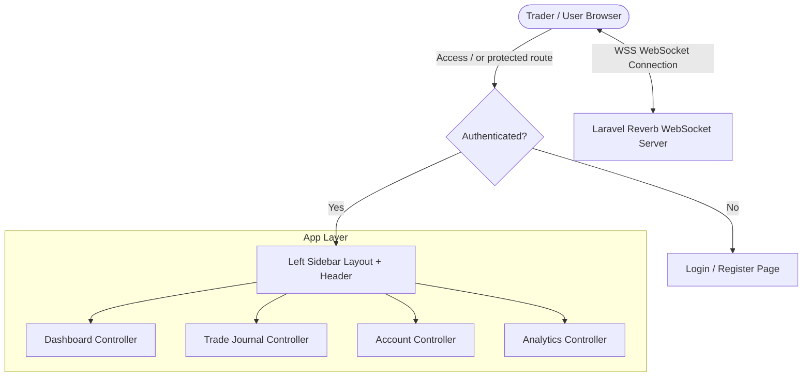

# System Architecture & Technical Design
## Project: Trading Journal & Performance Monitoring Dashboard

---

## 1. Tech Stack Selection & Justification

| Layer | Technology | Alasan Pemilihan |
| :--- | :--- | :--- |
| **Backend Framework** | **Laravel 12 (PHP 8.2+)** | ORM Eloquent, routing cepat, queue/event broadcasting terintegrasi, migrasi aman. |
| **WebSocket Engine** | **Laravel Reverb** | Server WebSocket official dari Laravel, blazing fast, asynchronous (built on ReactPHP/Amp), zero external subscription cost. |
| **Client Real-Time** | **Laravel Echo + Pusher-js** | Menghubungkan frontend ke Laravel Reverb secara mulus via private channels. |
| **Frontend Styling** | **Tailwind CSS v4** | Variable CSS kustom via `@theme`, dark mode native, performa build super cepat dengan Vite. |
| **Frontend Interactivity** | **Alpine.js & Blade Components** | Ringan, reaktif untuk mendengarkan WebSocket event, update DOM instan tanpa full page reload. |
| **Icon Library** | **Lucide Icons (`blade-lucide` / SVG)** | Icon SVG profesional, crisp, modern, no emojis/emotes policy. |
| **Notifications & Alerts** | **SweetAlert2 (`sweetalert2`)** | Modal konfirmasi & toast notifikasi yang disesuaikan dengan tema dark minimalis. |
| **Data Visualization** | **ApexCharts / Chart.js** | Visualisasi grafik keuangan interaktif (Equity curve, PnL histogram, Drawdown chart). |
| **Database** | **SQLite / PostgreSQL / MySQL** | Default SQLite untuk development cepat dan portable, kompatibel penuh dengan MySQL/PostgreSQL untuk production. |
| **File Storage** | **Laravel Storage (Local / S3)** | Penyimpanan screenshot chart Before & After transaksi secara aman dan terorganisir. |

---

## 2. System Architecture Diagram



    subgraph Data & Storage Layer
        AnalyticsService --> Eloquent[Eloquent ORM Models]
        TradeService --> Eloquent
        Eloquent --> Database[(Database SQLite / MySQL)]
        TradeService --> Storage[File Storage: Chart Screenshots]
    end

    subgraph Presentation Layer
        User --> BladeViews[Blade Views + Tailwind CSS v4]
        BladeViews --> LucideIcons[Lucide Icon SVG Components]
        BladeViews --> EchoListener[Laravel Echo + Alpine.js State Store]
        EchoListener --> LiveUI[Instant Real-time DOM & Chart Updates]
    end
```

---

## 3. Real-Time WebSocket Pipeline (Laravel Reverb)

### 3.1. Channel Design
- **Private Channel:** `private-user.{userId}`
  - Hanya user terautentikasi yang dapat subscribe ke channel miliknya.
  - Otorisasi diatur melalui `routes/channels.php`.

### 3.2. Broadcasted Events
1. **`TradeCreated`:** Dikirim saat ada trade baru ditambahkan (memperbarui recent trade table & KPI card secara live).
2. **`TradeUpdated`:** Dikirim saat trade ditutup / diubah (menghitung ulang PnL, Win Rate, dan mengupdate Equity Curve).
3. **`TradeDeleted`:** Menghapus trade dari tabel tanpa reload.
4. **`AccountBalanceUpdated`:** Memperbarui balance dan drawdown status secara live.

### 3.3. Client-Side Echo Integration (Alpine.js)
```javascript
// resources/js/echo.js
import Echo from 'laravel-echo';
import Pusher from 'pusher-js';
window.Pusher = Pusher;

window.Echo = new Echo({
    broadcaster: 'reverb',
    key: import.meta.env.VITE_REVERB_APP_KEY,
    wsHost: import.meta.env.VITE_REVERB_HOST ?? window.location.hostname,
    wsPort: import.meta.env.VITE_REVERB_PORT ?? 8080,
    wssPort: import.meta.env.VITE_REVERB_PORT ?? 443,
    forceTLS: (import.meta.env.VITE_REVERB_SCHEME ?? 'https') === 'https',
    enabledTransports: ['ws', 'wss'],
});
```

---

## 4. Frontend Styling & Design System Architecture

### 4.1. Dual-Theme Design Tokens & CSS Variables
Warna dan layout tokens dikonfigurasikan di `resources/css/app.css` menggunakan CSS Variables semantik (`:root` untuk Light Mode dan `.dark` untuk Dark Mode):
- **Canvas / Surface:**
  - **Light Mode:** Canvas `#F8FAFC`, Surface `#FFFFFF`, Elevated `#F1F5F9`, Subtle Border `#E2E8F0`.
  - **Dark Mode:** Canvas `#080B10`, Surface `#0F141C`, Elevated `#161C26`, Subtle Dark Border `#1A222D`.
- **Semantic Trading Colors:** Emerald Green (`#10B981` / `#059669`) untuk Profit/Long, Rose/Crimson (`#F43F5E` / `#E11D48`) untuk Loss/Short.
- **Theme Switcher:** Alpine.js reactive toggle switch di navigation header dengan persistensi `localStorage` dan head anti-FOUC script.
- **Typography:** Inter (Sans-serif) untuk UI labels, JetBrains Mono (Monospace) untuk seluruh data numerik & harga (`tabular-nums`).

### 4.2. Icon Policy
- Seluruh icon menggunakan SVG dari **Lucide Icons** via Blade component (contoh: `<x-lucide-trending-up class="w-4 h-4 text-trade-profit" />`) atau inline SVG helper.
- Tidak ada emoji teks yang digunakan untuk indikator UI.

---

## 5. Directory Structure (Updated)

```text
app/
├── Events/
│   ├── TradeCreated.php
│   ├── TradeUpdated.php
│   └── AccountBalanceUpdated.php
├── Http/
│   ├── Controllers/
│   │   ├── DashboardController.php
│   │   ├── TradeController.php
│   │   ├── AccountController.php
│   │   ├── StrategyController.php
│   │   └── ImportExportController.php
│   └── Requests/
│       ├── StoreTradeRequest.php
│       └── UpdateTradeRequest.php
├── Models/
│   ├── User.php
│   ├── Account.php
│   ├── Trade.php
│   ├── TradeAttachment.php
│   ├── Strategy.php
│   └── Tag.php
└── Services/
    ├── AnalyticsService.php
    ├── TradeCalculatorService.php
    └── CsvImportService.php
config/
│   └── reverb.php
resources/
├── css/
│   └── app.css (Tailwind v4 @theme tokens)
├── js/
│   ├── app.js
│   ├── echo.js (WebSocket Listener)
│   ├── alerts.js (SweetAlert2 Dark Theme Helper)
│   └── charts.js (ApexCharts / Chart.js wrappers)
└── views/
    ├── components/
    │   ├── icon/ (Lucide SVG icons)
    │   ├── kpi-card.blade.php
    │   ├── status-badge.blade.php
    │   └── live-indicator.blade.php
    ├── layouts/
    │   ├── app.blade.php
    │   └── navigation.blade.php
    ├── dashboard/
    │   └── index.blade.php
    └── trades/
        ├── index.blade.php
        ├── create.blade.php
        └── show.blade.php
routes/
├── channels.php (Private Channel Authorization)
└── web.php
```
