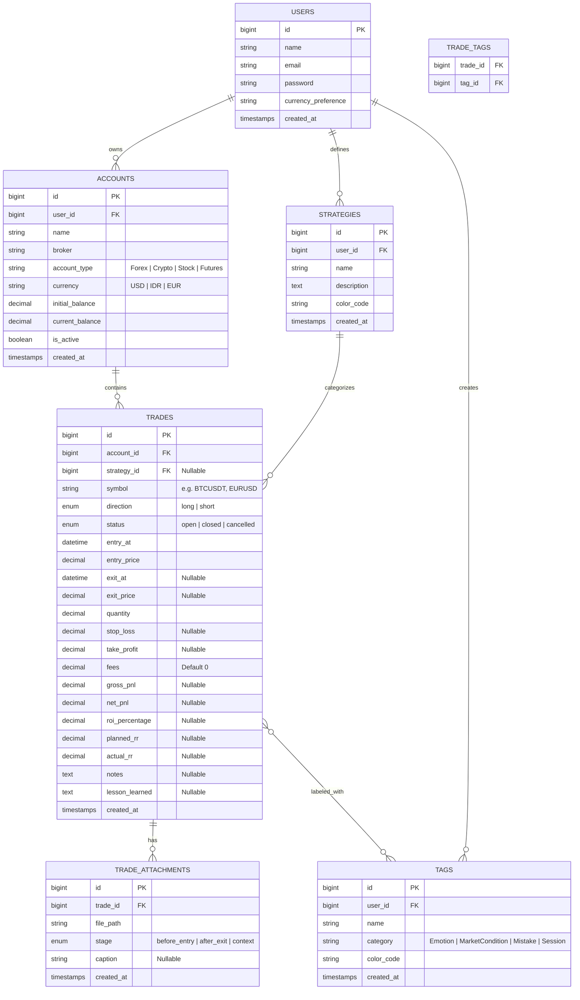

# Database Schema & Entity Relationships
## Project: Trading Journal & Performance Monitoring Dashboard

---

## 1. Entity Relationship Diagram (ERD)

---

## 2. Table Specifications & Indexes

### `accounts` Table
- `id` (BigIncrements, PK)
- `user_id` (ForeignId -> users.id, Cascade On Delete)
- `name` (String, e.g. "Main Binance Futures")
- `broker` (String nullable, e.g. "Binance", "FTMO", "ICMarkets")
- `account_type` (String, default: "forex")
- `currency` (String, default: "USD")
- `initial_balance` (Decimal 15,2)
- `current_balance` (Decimal 15,2)
- `is_active` (Boolean, default: true)
- `timestamps`

### `strategies` Table
- `id` (BigIncrements, PK)
- `user_id` (ForeignId -> users.id, Cascade On Delete)
- `name` (String, e.g. "Breakout Pullback")
- `description` (Text nullable)
- `color_code` (String nullable, default: "#3B82F6")
- `timestamps`

### `tags` Table
- `id` (BigIncrements, PK)
- `user_id` (ForeignId -> users.id, Cascade On Delete)
- `name` (String, e.g. "FOMO", "Disciplined", "London Session")
- `category` (Enum/String: 'emotion', 'mistake', 'market_condition', 'session')
- `color_code` (String nullable)
- `timestamps`

### `trades` Table
- `id` (BigIncrements, PK)
- `account_id` (ForeignId -> accounts.id, Cascade On Delete, Index)
- `strategy_id` (ForeignId -> strategies.id, Nullable, Null On Delete, Index)
- `symbol` (String, Index, e.g. "XAUUSD")
- `direction` (Enum: 'long', 'short')
- `status` (Enum: 'open', 'closed', 'cancelled')
- `entry_at` (DateTime, Index)
- `entry_price` (Decimal 18,8)
- `exit_at` (DateTime nullable, Index)
- `exit_price` (Decimal 18,8 nullable)
- `quantity` (Decimal 18,8)
- `stop_loss` (Decimal 18,8 nullable)
- `take_profit` (Decimal 18,8 nullable)
- `fees` (Decimal 15,2, default: 0)
- `gross_pnl` (Decimal 15,2 nullable)
- `net_pnl` (Decimal 15,2 nullable, Index)
- `roi_percentage` (Decimal 8,4 nullable)
- `planned_rr` (Decimal 8,2 nullable)
- `actual_rr` (Decimal 8,2 nullable)
- `notes` (Text nullable)
- `lesson_learned` (Text nullable)
- `timestamps`

### `trade_attachments` Table
- `id` (BigIncrements, PK)
- `trade_id` (ForeignId -> trades.id, Cascade On Delete, Index)
- `file_path` (String)
- `stage` (Enum: 'before_entry', 'after_exit', 'general')
- `caption` (String nullable)
- `timestamps`

### `trade_tag` (Pivot Table)
- `trade_id` (ForeignId -> trades.id, Cascade On Delete)
- `tag_id` (ForeignId -> tags.id, Cascade On Delete)
- Primary Key: `(trade_id, tag_id)`
