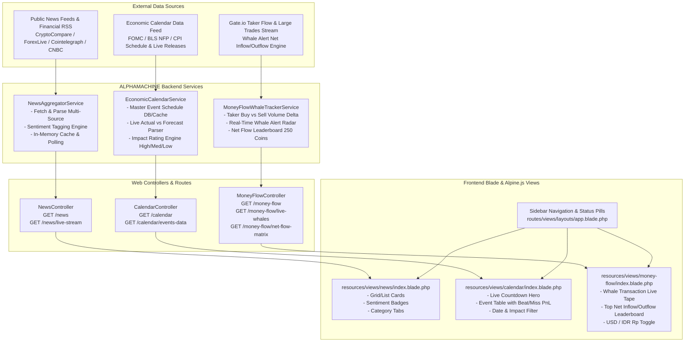

# 🏛️ ARSITEKTUR & RENCANA IMPLEMENTASI 3 MENU BARU ALPHAMACHINE
## 1. Berita Dunia • 2. Kalender Ekonomi (FOMC/NFP) • 3. Money Flow & Whale Tracker

> **Status:** Proposal Rencana Arsitektur & UI/UX  
> **Target Aplikasi:** ALPHAMACHINE Pro Trading Terminal  
> **Standar UI:** Zero Unicode Emojis, Standard `<x-app-icon>`, Kurs 1 USD = Rp 17.756,00, Real-Time Dynamic Updates

---

## 📌 Ringkasan Eksekutif

Rencana ini merancang penambahan **3 menu baru** berkemampuan real-time ke dalam ekosistem **ALPHAMACHINE**:
1. **Berita Dunia (`/news`):** Portal agregasi berita ekonomi makro, geopolitik, forex, dan kripto real-time dengan analisis sentimen instan (Bullish / Bearish / Neutral), filter kategori, dan auto-stream update.
2. **Kalender Ekonomi & Events (`/calendar`):** Kalender rilis data ekonomi berbobot tinggi (*High Impact*) seperti **FOMC Rate Decisions, Non-Farm Payrolls (NFP), US CPI Inflation, GDP, Token Unlocks, dan Central Bank Speeches** dengan fitur *Live Countdown Timer*, metrik *Actual vs Forecast vs Previous*, serta indikator deviasi pasar.
3. **Money Flow & Whale Tracker (`/money-flow`):** Pemindai arus modal institusional & pergerakan transaksi paus (*Whale Alert*) berskala besar ($1M – $100M+) secara real-time, grafik arus masuk bersih (*Net Inflow/Outflow*) 24H/4H/1H untuk 250 koin, serta deteksi akumulasi vs distribusi bursa (*Exchange Inflow vs Outflow*).

---

## 📐 Arsitektur Sistem & Alur Data (System Architecture)



---

## 🚀 1. Modul Berita Dunia (`/news`)

### A. Fitur Utama
- **Agregasi Multi-Pasar:** Menggabungkan berita pasar **Kripto (BTC, ETH, Altcoins)**, **Forex (EUR/USD, GBP/USD, DXY, JPY)**, dan **Makroekonomi Global (The Fed, ECB, Inflasi, Minyak/Komoditas)**.
- **Analisis Sentimen Otomatis:** Deteksi nada sentimen berbasis kata kunci kontekstual (*Bullish* hijau, *Bearish* merah, *Neutral* abu-abu) untuk membantu pengambilan keputusan cepat.
- **Filter Berdasarkan Kategori:**
  - *Semua Berita (All Markets)*
  - *Crypto Focus*
  - *Forex & Mata Uang*
  - *Bank Sentral & The Fed*
  - *High Impact News*
- **Tampilan Fleksibel (Card Grid vs Compact List):** Trader dapat memilih tata letak kartu visual modern atau daftar kompak cepat baca.
- **Real-Time Polling & Auto-Refresh:** Polling otomatis setiap 15–30 detik dengan tombol *Refresh Now* manual dan penanda "Baru saja" (*Time Ago*).

---

## 📅 2. Modul Kalender Ekonomi & FOMC/NFP (`/calendar`)

### A. Fitur Utama
- **Jadwal Rilis Berita Berbobot Tinggi (High Impact Focus):**
  - **FOMC Meeting & Federal Funds Rate Decision** (Keputusan Suku Bunga AS)
  - **Non-Farm Payrolls (NFP)** & US Unemployment Rate
  - **US Consumer Price Index (CPI)** & Core Inflation MoM/YoY
  - **Core PCE Price Index** (Ukuran inflasi favorit The Fed)
  - **Gross Domestic Product (GDP)** AS & Uni Eropa
  - **Major Crypto Events:** Bitcoin Halving, Token Unlock $50M+, Jaringan Upgrade Utama.
- **Live Countdown Timer ke Rilis Penting Berikutnya:**
  Hero widget di bagian atas halaman dengan countdown detik-demi-detik ke rilis *High Impact* terdekat (contoh: `Rilis US CPI (MoM): 1 Hari 06 Jam 42 Menit 18 Detik`).
- **Analisis Deviasi Angka (Actual vs Forecast vs Previous):**
  - *Beat (Angka Lebih Baik / Bullish USD)* $\rightarrow$ Badge Hijau
  - *Miss (Angka Lebih Rendah / Bearish USD)* $\rightarrow$ Badge Merah
  - *In-Line (Sesuai Ekspektasi)* $\rightarrow$ Badge Netral
- **Filter Waktu & Mata Uang:**
  - Pilihan rentang: *Hari Ini*, *Minggu Ini*, *Bulan Ini*, *Event Mendatang*.
  - Pilihan aset: *Semua*, *USD (AS)*, *EUR (Eropa)*, *GBP (Inggris)*, *JPY (Jepang)*, *CRYPTO*.

---

## 🐋 3. Modul Money Flow & Whale Tracker (`/money-flow`)

### A. Fitur Utama
- **Whale Transactions Radar (Live Large Trade Tape):**
  - Mendeteksi transaksi paus berskala masif secara real-time:
    - Transaksi Spot/Futures $> \$1.000.000$ (Tier 1)
    - Transaksi Spot/Futures $> \$10.000.000$ (Tier 2 - Mega Whale)
    - Transaksi Spot/Futures $> \$50.000.000 – \$100.000.000+$ (Tier 3 - Super Whale)
  - Detail transaksi: Waktu eksekusi, Koin target (BTC, ETH, SOL, XRP, DOGE, dll.), Arah (Beli Agresif / Jual Masif), Tipe Aksi (*Exchange Inflow* / *Exchange Outflow* / *Whale-to-Whale Transfer*).
- **Net Capital Inflow / Outflow Matrix (250 Koin):**
  - Menghitung delta bersih volume beli vs volume jual (*Taker Buy Volume minus Taker Sell Volume*) dalam rentang 1 Jam, 4 Jam, dan 24 Jam.
  - **Leaderboard Top 10 Inflow:** Koin yang sedang diborong paus (*Institutional Buying Pressure*).
  - **Leaderboard Top 10 Outflow:** Koin yang sedang dibuang/distribusi (*Heavy Selling Pressure*).
- **Konversi Mata Uang Fleksibel (USD vs Rupiah IDR):**
  - Menampilkan nominal volume dalam USD (`$100.0M`) atau Rupiah (`Rp 1,775 Triliun`) sesuai preferensi pengguna menggunakan kurs standar 1 USD = Rp 17.756,00.

---

## 🗂️ Rencana Berkas & Struktur File Baru

```
app/
├── Http/
│   └── Controllers/
│       ├── NewsController.php               [NEW]
│       ├── EconomicCalendarController.php   [NEW]
│       └── MoneyFlowController.php          [NEW]
├── Services/
│   ├── NewsAggregatorService.php            [NEW]
│   ├── EconomicCalendarService.php          [NEW]
│   └── MoneyFlowWhaleTrackerService.php     [NEW]
routes/
└── web.php                                  [MODIFY] (Daftarkan route /news, /calendar, /money-flow)
resources/
├── views/
│   ├── layouts/
│   │   └── app.blade.php                    [MODIFY] (Tambahkan 3 link navigasi & icon di sidebar)
│   ├── components/
│   │   └── app-icon.blade.php               [MODIFY] (Tambahkan icon globe, newspaper, waves)
│   ├── news/
│   │   └── index.blade.php                  [NEW]
│   ├── calendar/
│   │   └── index.blade.php                  [NEW]
│   └── money-flow/
│       └── index.blade.php                  [NEW]
tests/
└── Feature/
    ├── GlobalNewsTest.php                   [NEW]
    ├── EconomicCalendarTest.php             [NEW]
    └── MoneyFlowWhaleTrackerTest.php        [NEW]
```

---

## ⏱️ Rencana Tahapan Eksekusi (Implementation Milestones)

| Tahap | Modul & Fokus Pekerjaan | Output & Verifikasi |
|---|---|---|
| **Fase 1** | **Fondasi Service & Icon Helper**<br>• Daftarkan icon `globe`, `newspaper`, `waves`, `calendar-days`<br>• Implementasikan `NewsAggregatorService`, `EconomicCalendarService`, `MoneyFlowWhaleTrackerService` | Unit test parser data, cache warm-up, rate limit guard. |
| **Fase 2** | **Controller & API Endpoints**<br>• Buat `NewsController`, `EconomicCalendarController`, `MoneyFlowController`<br>• Daftarkan routes web dan live JSON polling endpoints di `routes/web.php` | Request test status 200 OK & JSON schema valid. |
| **Fase 3** | **Tampilan UI Blade & Alpine.js**<br>• Buat `news/index.blade.php`, `calendar/index.blade.php`, `money-flow/index.blade.php`<br>• Hubungkan sidebar nav di `layouts/app.blade.php`<br>• Integrasikan toggle USD/IDR (1 USD = Rp 17.756,00) | Tampilan dark-theme responsif tanpa emoji, visual tajam. |
| **Fase 4** | **Pengujian & Build Akhir**<br>• Tulis Feature Tests untuk seluruh 3 modul<br>• Kompilasi aset Vite `npm run build`<br>• Jalankan full test suite `php artisan test` | Semua automated tests lulus 100%. |

---

## 🔒 Kepatuhan Terhadap Standar Proyek (Standard Rules Compliance)
1. **Zero Emoticon Rule:** Tidak ada unicode emoji di Blade template. Seluruh representasi visual menggunakan komponen SVG `<x-app-icon name="..." />`.
2. **Standard Exchange Rate:** Kurs Rupiah dikunci secara seragam pada **1 USD = Rp 17.756,00** dengan dukungan penyimpanan preferensi *persistent* di `localStorage`.
3. **Dokumentasi Terstruktur:** Rencana arsitektur ini disimpan di `plan_architecture/PLAN_BERITA_DUNIA_KALENDER_MONEY_FLOW.md`.
